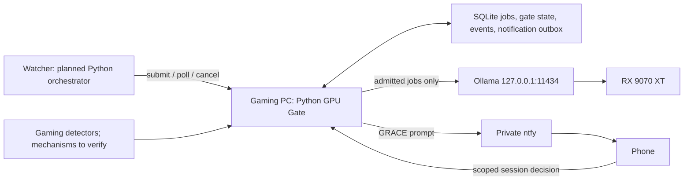

# 11 — GPU Gate Spec

> [!tip] Short reading path
> [[10 - GPU Gate in Plain English|Plain-English guide]] · [[21 - Fallacies and Sanity Check|Sanity-check findings]]. This document retains the technical detail; the guide links here rather than copying its settings.

**Implementation language: Python**, as requested by the user on 2026-10-07. One systemd-managed service on the gaming PC arbitrates access to its RX 9070 XT and proxies admitted jobs to local Ollama. The orchestrator is also planned in Python on watcher (ADR-017); its earlier TypeScript experiment has been removed. SQLite remains the queue store; the earlier Hono/better-sqlite3/execa implementation sketch no longer applies to Gate.

**Why:** this is a local I/O and scheduling service with HTTP, detector polling and durable state. Python supports those responsibilities without changing the architecture or adding another database service. The detailed contracts and test cases are in [[13 - GPU Gate Low-Level Design]]. No Gate implementation or deployment is claimed by this document.

## Verified baseline and evidence

The evidence below is the local **Ollama-only, read-only inspection on 2026-10-06**, plus the user's hardware confirmation and the orchestrator work from that date. No new hardware, network or gaming inspection is implied.

| Item | Established state |
|---|---|
| Machine | The local machine used for the investigation is the user's RX 9070 XT gaming PC |
| Ollama | CLI and server report **0.34.1**; `/usr/local/bin/ollama serve`; system service active/running and enabled at boot |
| Listener | **127.0.0.1:11434**; watcher cannot directly use this loopback listener |
| Selected model | `gpt-oss:20b` installed; reported 20.9B, MXFP4; downloaded size 13,793,441,244 bytes, not a VRAM measurement |
| Other models | `qwen2.5-coder:14b`, `qwen3.5:9b` installed; not automatically eligible Gate models |
| Context setting | Service environment reports `OLLAMA_CONTEXT_LENGTH=65536`; effective memory use and performance at that setting are unmeasured |
| Loaded models | `/api/ps` returned an empty list at inspection; daemon runs continuously, models load on demand |
| Compatibility surface | Read-only `/v1/models` succeeded; no generation or structured-output request was tested |
| GPU use | GPU offload/backend, cancellation, VRAM release and model latency were not verified; matching GPU evidence was absent from the accessible journal sample |
| Gate | Not built. Repository location/conventions have not been supplied |
| Orchestrator | Earlier undeployed implementation removed on 2026-10-07; watcher `/opt/observability`, branch `feat/orchestrator`, clean. Python design in doc 17; no replacement code |

Pop!_OS is the documented OS choice, not a fresh OS audit. GameMode, Sunshine, detector permissions, AMD telemetry, tailnet routing, hostname, suspend and WoL remain unverified. Installed software/model versions above are observations, not upgrade instructions.

## Placement and responsibility boundary

Gate owns admission, queueing, its inference requests and resource reconciliation. It must not fetch homelab logs, inspect Proxmox, validate remediation actions, execute model tools, select cloud fallbacks or approve recovery plans. Those belong to the orchestrator. A gaming-session response is separate from an incident approval.

Ollama stays on loopback. Gate is the planned sole remote inference entry point, nominal port 11435 over private tailnet connectivity with bearer authentication. Actual bind/proxy/HTTPS arrangement and watcher-to-Gate routing are deployment decisions: watcher's existing ntfy Tailscale container does not establish this route. No public or LAN-wide bind is assumed.

## Availability state and gaming detection

Preserve the architectural states **IDLE**, **BUSY**, **GRACE** and the 20-minute unanswered-GRACE policy. Add a proposed **BLOCKED** state for startup, stale/failed required detection, unknown backend activity and incomplete resource cleanup. Startup must not imply idle GPU availability.

- **IDLE:** eligible to admit a job only when the single inference slot is free and fresh detector/resource checks pass.
- **BUSY:** no inference starts. Accepted queued jobs continue consuming their original queue/attempt budgets.
- **GRACE:** following 60 seconds of confirmed all-clear after gaming, send one logical “Done gaming / Still playing” prompt. New gaming cancels that prompt. Twenty minutes of continuously verified idle observations without a reply permits IDLE; detector uncertainty cannot count towards this interval.
- **BLOCKED:** no new inference; status explains a bounded reason. Recovery requires fresh observations and reconciled resource ownership, not an elapsed timer alone.

**User direction — 2026-10-07:** GPU usage is the primary resource metric. Add algorithmic Steam/Lutris/Heroic game-session discovery without a user-maintained game list. The earlier two-signal rule and the initial single-strong-signal replacement are not the selected design direction.

[[12 - GPU Usage and Automatic Game Detection Proposal]] supplies the concrete plan for review: ≥30% GPU busy holds admission; ≤10% for 60s restores resource eligibility; automatic session evidence adds a proposed low-load gaming veto. Those numeric settings and detailed veto/cooldown rules are **not yet approved**. GPU utilisation is an admission metric; it must not cancel Gate's own inference merely because generation drives utilisation up. VRAM capacity is checked separately.

The proposal uses amdgpu telemetry plus launcher provenance, inherited markers, process identity/ancestry and rendering evidence, with no game-title list. Exact installed interfaces, native/Flatpak coverage and service-user permissions need read-only verification. GameMode/Sunshine are optional corroboration. The proposed GPU and process intervals are 1s and 2s respectively, replacing the earlier undifferentiated 5s poll sketch if accepted.

## Job API and watcher compatibility

The following **provisional wire contract** originated in the removed TypeScript experiment and is retained as the common design for both Python services. See [[17 - Orchestrator Low-Level Design]]; no caller/server is currently implemented. The user selected **incident-only v1**; the old batch/experimental queue and priority extension are deferred.

| Route | Method | Contract |
|---|---|---|
| `/jobs` | POST | Bearer + `Idempotency-Key`; body has `incident_job_id`, `model`, `prompt`, `expires_at`, `start_not_after`, `max_queue_wait_ms`. Persist then return `202` with `job_id` and `state`; never hold the request open for generation |
| `/jobs/{id}` | GET | Same `job_id`; `state` is `queued`, `loading`, `running`, `done`, `failed`, `cancelled` or `expired`; `done` includes `result` as a JSON-plan **string** |
| `/jobs/{id}/cancel` | POST | Idempotent cancellation request with JSON response; logical cancellation is separate from confirmed backend/resource release |
| `/status` | GET | Authenticated cached state, queue depth, detector freshness, resource block reason and worker health; no prompt/result/credential content |
| `/sessions/{id}/decision` | POST | Private phone callback for current GRACE session with single-use, session-bound authority; security design accepted, hostname/deployment details pending |
| `/override` | POST | Accepted guarded controls: pause inference and return-to-automatic; neither bypasses resource checks, active gaming, failed detection or uncertain backend state |

The original `{prompt, model, format, priority}` and synchronous `200 {result}` path are incompatible with the watcher adapter. `incident_job_id` carries an **inference attempt UUID**, not the orchestrator incident ID; retain that provisional wire name consistently in both LLDs. The Gate does not need to understand the incident database.

## Queue, deadline and resource rules

- Single Gate process, single local inference slot, durable FIFO among eligible waiting jobs. Immediate-admission jobs must not jump over accepted waiting jobs. Queue capacity is bounded; see the LLD's proposed settings.
- No implicit ten-minute queue TTL. `expires_at` is the whole attempt deadline. For positive queue allowance, admission deadline is the earliest of `start_not_after`, receipt time plus `max_queue_wait_ms`, and `expires_at`. Never extend any of these on retry/restart.
- `max_queue_wait_ms=0` means atomically reserve the currently available slot or return a stable rejection. A critical request must not become `queued` while it is in transit. The proposed caller sets `start_not_after=expires_at`.
- The removed watcher experiment used 120s attempts, 30s warning queue wait and zero critical queue wait. Doc 17 now proposes explicit stage budgets inside the user-confirmed **600s from webhook receipt**, with **≤300s context age** at result acceptance; these are not measured latency guarantees. The 20-minute GRACE policy does not lengthen them.
- Same authenticated caller/key and identical canonical input returns the same job/outcome; changed input returns a conflict. A lost acknowledgement never starts duplicate generation. Accepted retention: prompt/result bodies for 24h after terminal state, minimal metadata/idempotency records for seven days; reconcile uncertain resources independently of payload retention.
- Persist intent before contacting Ollama. Never transparently retry a generation POST with uncertain outcome. Expiry/cancellation prevents a late result becoming `done`.
- When gaming starts, stop admission and request cancellation of Gate-owned work. Hold the slot blocked until safe release is established. Closing HTTP alone is not proof of backend termination or released VRAM.
- After Gate restart, retained queued work is revalidated; interrupted inference is failed/reconciled rather than resubmitted. The user selected watcher restart recovery that resumes an existing eligible Gate job under its original deadline and freshness checks. Gate restart still fails interrupted generation and reconciles resources; it never replays generation.

## Confirmed operating choices — 2026-10-07

- **Shared Ollama:** occasional direct coding/chat use must coexist. Gate controls its own requests only; no automatic shared-service restart, runner kill or model-wide unload. Request-level attribution limitations and a conservative admission proposal appear in doc 12.
- **Incident-only v1:** no batch queue or 24h experimental jobs.
- **Security:** private tailnet access, separate watcher/operator credentials, single-use ntfy session buttons. Exact address, private HTTPS route and ACLs remain deployment work.
- **Retention:** delete prompt/result bodies 24h after terminal completion; retain minimal job/idempotency records seven days. Watcher owns the separate incident audit. Physical backup/WAL expiry must follow this policy without claiming instant secure erasure.
- **Controls:** pause inference / return to automatic; Done gaming may end GRACE only when detectors/resource checks are clear. There is no unconditional force-IDLE.

Recorded in [[06 - Decision Log|ADR-016]]. The detector thresholds and detailed algorithm remain a review proposal, not an implementation claim.

## Runtime configuration

**User-confirmed direction — 2026-10-13:** use an operator TOML configuration file for GPU thresholds, quiet periods, detector polling/freshness timings and other operational settings. Load it through `load_settings` using standard-library `tomllib`, validate it at startup and pass immutable settings to policy and detector functions. These values must not be fixed constants in functional code.

**Why:** the operator can calibrate the service by editing a readable file and restarting it, without editing code or rebuilding the application. Initial v1 applies changes only on restart; automatic reload and live policy changes are deferred.

Commit an example configuration with clearly labelled proposed values. Keep the actual machine-specific configuration outside Git and reference separate credential files through the existing secret-reader contract. TOML is the v1 settings source; a `.env` parser or multiple overlapping sources are not required.

Validate `0 <= release_percent < hold_percent <= 100`, require finite positive quiet periods and polling/freshness durations, reject booleans as numeric settings and reject unknown fields. Missing required values, malformed TOML or invalid settings must fail startup with a field-specific error that does not expose credentials. Configuration flexibility does not approve doc 12's numerical thresholds or detection algorithm; those still require review and measurement. GPU resource quiet time remains separate from the documented gaming all-clear and GRACE timers.

## Python implementation and operations

Proposed stack: Python 3.12+ syntax baseline, FastAPI/Pydantic for strict HTTP DTOs, HTTPX for bounded asynchronous HTTP, standard-library `sqlite3` in a dedicated serial database worker, asyncio supervision and pytest. Exact interpreter/dependency versions and lock tooling are selected after the Gate repository and host support are available. No line-count promise: cancellation/recovery and detector testing are substantial parts of this service.

**User-confirmed deployment direction — 2026-10-13:** keep the initial Gate deployment native under systemd; Docker packaging is deferred. This preserves the planned host process/telemetry access while those adapters are being verified.

Run one ASGI worker without auto-reload, under an unprivileged systemd identity. Store queue/state in a private persistent directory. Poll detectors without shell interpolation and with time/output limits. Journal metadata/state transitions only; protect prompts/results in SQLite and never put them in journald, `/status` or ntfy gaming prompts. Do not give the Gate Proxmox or Docker privileges.

Gate should start at boot once deployed; Ollama already does. `After=ollama.service` supplies ordering, not API readiness. WoL configuration and successful wake time are unverified; the previous “~1 min” statement was a target, not evidence. Suspend policy remains an explicit user decision. Gate cannot wake its own powered-off host; the future watcher WoL path owns that action.

## Completion criteria and remaining decisions

Canonical acceptance stays in [[Software/Projects/self-healing-homelab-docs/homelab-self-healing/Tasks|Tasks]]. No Gate test or live acceptance item is completed by this design review.

Before enabling real inference: review the GPU-first detection proposal and prove shared-Ollama request ownership/release; establish detector APIs/permissions, cancellation/release evidence, private network/auth routes and retention implementation; pin dependencies; then verify the future Python orchestrator adapter against the Python Gate API. Measure cold-load, end-to-end plan latency and gaming impact with `gpt-oss:20b` and the actual context setting. Keep readiness blocked wherever required evidence is missing.
