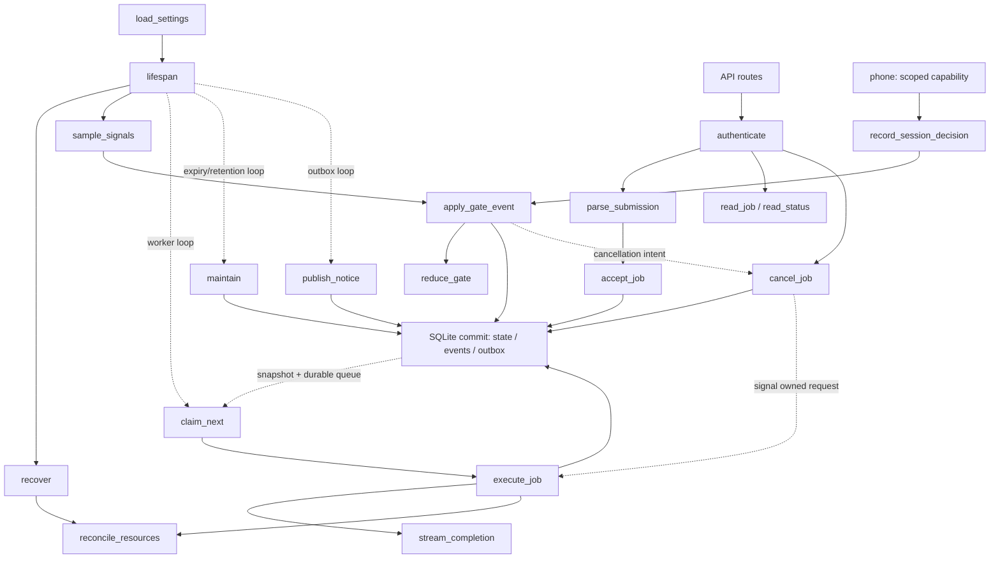
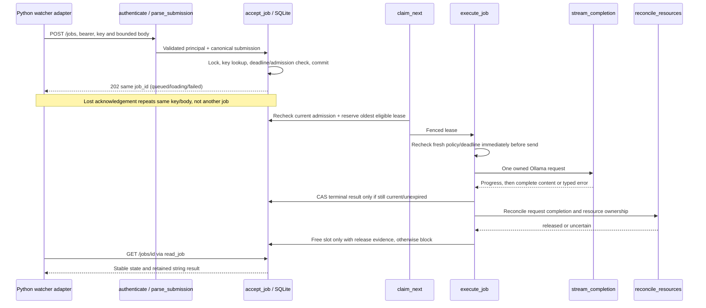
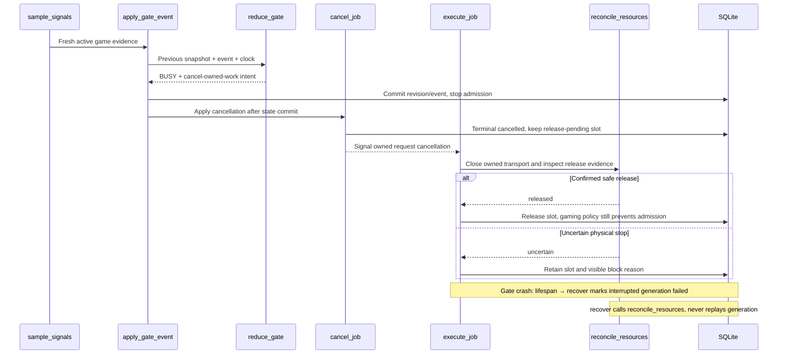
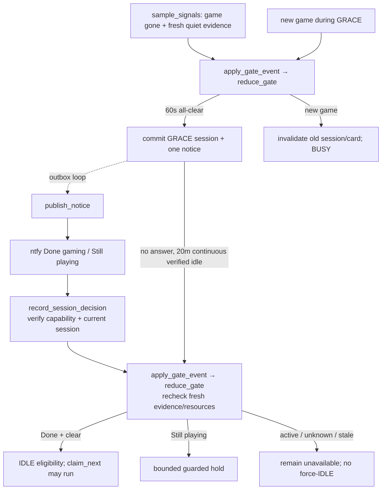

# 13 — GPU Gate Low-Level Design

> [!tip] Short reading path
> [[10 - GPU Gate in Plain English|Plain-English guide]] · [[21 - Fallacies and Sanity Check|Sanity-check findings]]. This document retains the technical detail; the guide links here rather than copying its settings.

**Recommendation:** implement one Python service with a small pure policy module, a serial SQLite store and supervised asynchronous I/O. Keep admission and resource ownership explicit; a completed HTTP request must never be mistaken for an available GPU.

**Why:** this preserves the local systemd/SQLite architecture, shares the documented wire contract with the planned Python watcher adapter and makes timing, cancellation and restart failures testable without loading a model or touching a game.

This is **design documentation, not implementation**. Python is user-selected. The function contracts below are ready for implementation with fakes; detection choices marked **pending review** and hardware-dependent adapters must be resolved before their production behaviour is finalised. No GPU Gate repository has been supplied, so no repository-specific conventions or dependency versions have been verified. Suggested layout follows a `src/gpu_gate/` package and `tests/{unit,integration,contract}`; do not put product code in this vault.

## 1. Sources, scope and decisions

| Ref | Source / requirement |
|---|---|
| S1 | [[11 - GPU Gate Spec#Verified baseline and evidence]] — observed Ollama version, loopback binding, installed models and context setting |
| S2 | [[11 - GPU Gate Spec#Availability state and gaming detection]]; historical ADR-011 — gaming priority, BUSY/GRACE/IDLE, 60s all-clear, 20m GRACE |
| S3 | [[11 - GPU Gate Spec#Job API and watcher compatibility]] and [[17 - Orchestrator Low-Level Design]] — provisional caller fields and response states retained from the now-removed 2026-10-06 experiment |
| S4 | [[16 - Inference and Approval Design Proposal#Cancellation, stale plans and gaming protection]] — bounded attempts, cancellation, stale output, resource reconciliation |
| S5 | [[03 - Architecture#Component responsibilities]] and [[18 - Security & Guardrails]] — Gate/Ollama/orchestrator separation, private access, no executor authority |
| S6 | [[Software/Projects/self-healing-homelab-docs/homelab-self-healing/19 - Test Plan]] and [[Software/Projects/self-healing-homelab-docs/homelab-self-healing/Tasks|Tasks]] — acceptance remains uncompleted |
| S8 | [[12 - GPU Usage and Automatic Game Detection Proposal]] — GPU-first admission, automatic launcher provenance, own-load distinction (proposal pending review) |
| S7 | [[06 - Decision Log#ADR-006 — SQLite everywhere (gate queue + orchestrator state/audit)]] — durable SQLite, no Redis/Postgres; Python binding replaces Gate's old JS binding |

Observed state is dated evidence, not a claim that it was rechecked on 2026-10-07. Gate work remains documentation only. The separate orchestrator rollback on watcher is recorded in doc 17; no Gate runtime changes occurred. Other installed Ollama models are outside the initial Gate allowlist; Gate must never pull/delete a model or change the system service configuration.

### Decision register

| ID | Status | Decision / proposal and consequence |
|---|---|---|
| D1 | Confirmed by user | Python for both Gate and watcher orchestrator; prior watcher experiment removed (ADR-017) |
| D2 | Direction confirmed; algorithm pending review | GPU usage primary plus automatic Steam/Lutris/Heroic session detection, no game list. Thresholds and low-load veto proposed in [[12 - GPU Usage and Automatic Game Detection Proposal]] |
| D3 | Confirmed by user | Shared Ollama with occasional direct coding tasks. Gate owns only its requests; no shared runner/service kill or model-wide unload |
| D4 | Confirmed by user | Incident-only v1 using the provisional asynchronous watcher contract; batch work deferred |
| D5 | Confirmed design; deployment pending | Private tailnet access, separate caller/operator credentials and single-use phone capabilities; exact hostname/proxy/ACL/secret paths TBC |
| D6 | Confirmed by user | Purge prompt/result bodies 24h after terminal state; retain minimal metadata/idempotency tombstones 7d; orchestrator holds its separate incident audit |
| D7 | Confirmed by user | Pause inference or return-to-auto; Done gaming bypasses remaining GRACE only after fresh all-clear, never active gaming or resource uncertainty |
| D8 | Engineering proposal | Python 3.12+ syntax, FastAPI/Pydantic, HTTPX, standard `sqlite3`, pytest; pin tested versions in the future repository; no ORM/task broker |
| D9 | Confirmed by user, 2026-10-13 | Operator TOML settings for tunable GPU thresholds and timings; validate at startup, apply edits on restart, commit examples and keep actual local config outside Git. Numerical D2 choices remain pending review |
| D10 | Confirmed by user, 2026-10-13 | Initial native systemd deployment; Docker packaging deferred |

The user answered the six questions on 2026-10-07; D3–D7 are accepted in ADR-016. D2 now follows the user's GPU-first/no-game-list direction; the numerical settings and algorithm in doc 12 await review. They replace the earlier pure signal-count recommendation as the active proposal. No-gaming-impact remains a test target, not a result of HTTP abort alone.

## 2. Modules and dependency direction

| Module | Owns / public interfaces | Explicitly outside scope | Dependencies / owned state |
|---|---|---|---|
| `config.py` | `load_settings`; immutable validated settings | Installing software, guessing devices/addresses | File reader; secret references, approved limits |
| `contracts.py` | DTOs, enums, `parse_submission`, error codes | Scheduling, network, model-plan validation | Pure types; no mutable state |
| `auth.py` | `authenticate`; role checks, capability digest comparison | Tailnet provisioning; issuing global credentials | Secret reader/constant-time comparison; caller identity |
| `detectors.py` | `sample_signals`; adapters normalise observations | Deciding BUSY, killing processes, arbitrary shell | Fixed read-only probes; latest observations, not policy |
| `policy.py` | `reduce_gate`; pure availability transitions | HTTP/SQLite/notifications | Clock readings, settings, prior snapshot; no I/O |
| `store.py` | `accept_job`, `claim_next`, `cancel_job`, terminal compare-and-set, reads, `maintain` | Awaiting inference while a transaction is open | One serial SQLite worker; sole durable-state writer |
| `controller.py` | `apply_gate_event`, `record_session_decision`; admission coordination | Model generation, SQL details, detector parsing | Policy/store; one asyncio admission lock; snapshot generation |
| `worker.py` | `execute_job`, `recover`; one supervised inference task | Retry uncertain generation, cloud failover, plan validation | Store/backend/controller; cancellation events, active handle |
| `ollama.py` | `stream_completion`, `reconcile_resources` | Shell tools, service restarts, other-client cancellation | Fixed loopback HTTPX client; owned stream handles only |
| `notifications.py` | `publish_notice`; ntfy gaming-session outbox | Recovery-plan approvals, incident context publication | Fixed private ntfy URL, publisher credential, outbox |
| `api.py` | Route validation/auth/error mapping; `read_job`, `read_status` | Durable request work in framework background tasks | Controller/store; no independent scheduler |
| `app.py` | `lifespan`; startup/recovery/task supervision/shutdown | Provisioning systemd/network/GPU | All components; process lock, task group, stop event |

Dependency direction: HTTP and runtime call controller/worker; these call pure policy, store and I/O adapters. Policy/types import no higher layers. Store never calls Ollama or ntfy. Backend returns observations/outcomes, never imports HTTP routes. One ASGI process/worker; a process-level lock on the state directory rejects a second instance even if mistakenly configured.

SQLite operations execute on one dedicated worker thread with a connection created there. Async callers await typed store operations, never share the connection with request threads. `BEGIN IMMEDIATE`, WAL, foreign keys and a bounded busy timeout are explicit. Transactions contain only local checks/writes. Cancellation of an awaiting HTTP task must not interrupt an already-started transaction; retry by idempotency key resolves its outcome. [Python SQLite reference](https://docs.python.org/3/library/sqlite3.html).

## 3. Shared types, persistence and protocol

Signatures below use Python type notation; type aliases are design contracts, not runnable code.

| Type | Required fields / invariant |
|---|---|
| `Principal` | Stable caller ID and roles: submit/read/cancel-own; operator role separate; no token value |
| `SubmitRequest` | Exactly `incident_job_id: str`, `model: str`, `prompt: str`, `expires_at: datetime`, `start_not_after: datetime`, `max_queue_wait_ms: int` |
| `ClockReading` | UTC wall time, monotonic time, boot ID; injected in tests |
| `Signal` | Source ID, `active / clear / unknown`, observation monotonic timestamp, bounded reason; graphics percentage optional |
| `DetectorSnapshot` | Required/enabled sources, observations, resource status; disabled-by-config differs from a failing enabled detector |
| `GateSnapshot` | `IDLE / BUSY / GRACE / BLOCKED`, monotonic revision, last gaming/clear times, grace session ID/start, optional operator hold, block reasons |
| `JobView` | Wire `job_id`, `state`, optional `result` only for done, optional bounded `error` code; no prompt |
| `Lease` | Job ID, random execution token, gate revision, immutable request, absolute and monotonic execution deadlines |
| `BackendOutcome` | Completed content string + safe timings, or typed failure; never tool execution |
| `ReleaseEvidence` | `released / uncertain`, evidence timestamp/method, ownership scope; a closed stream is insufficient alone |
| `GateEvent` | Detector update, timer tick, explicit operator hold/release, session decision or resource update |

Proposed input bounds: attempt/key ASCII `[A-Za-z0-9_-]{1,128}` (UUID accepted), equal header key and `incident_job_id`; prompt 1–32,768 UTF-8 bytes; full body ≤65,536 bytes; fixed allowlist initially `gpt-oss:20b`; reject extra fields and booleans masquerading as integers. Both timestamps require timezone offsets, normalised to UTC; expiry in `(now, now+600s]`; `now < start_not_after <= expires_at`; queue allowance 0–600,000ms. Proposed Python caller's ≤24 KiB prompt fits. No caller-supplied backend URL, tools, priority, arbitrary Ollama options or model-management fields.

Canonical input hash: SHA-256 of stable UTF-8 JSON of validated fields in fixed order, UTC timestamps at millisecond precision, prompt text preserved exactly. Key scope is `(principal_id, idempotency_key)`. Authenticate before all lookups. Lookup a retained key before rejecting a now-expired original deadline: identical retry returns its retained outcome; different hash returns 409. A new expired request returns 422. Tombstone expiry never authorises reuse of old expired deadlines.

### Durable tables

| Table | Fields / constraints |
|---|---|
| `jobs` | ID, owner/key unique, canonical hash, accepted sequence, immutable request/deadlines, state/version, execution token, `cancel_requested`, error/result, created/updated/terminal timestamps |
| `resource_slot` | Singleton: free or job/execution token, `release_pending`, reason. SQL constraint plus transaction prevents two active leases |
| `gate_state` | Singleton revision/snapshot, session/hold identifiers; monotonic values tagged by boot and never reused across boots |
| `events` | Append-only during retention: sequence, job/session, transition, bounded reason/timing; no prompt, result, bearer or capability. D6-authorised retention may delete whole expired event sets |
| `notices` | Session-keyed outbox, due time/tries/state, encrypted-or-reconstructible callback authority as below; unique logical prompt per session |
| `capabilities` | SHA-256 token digest, session/action/expiry, consumed decision/result; token never logged |
| `schema_version` | Explicit migration version; unsupported/newer schema prevents start |

Request/result bodies are private operational data, not journald audit. State directory 0700, DB/WAL/backups service-user-only, no repo commits. Orchestrator remains the long-term incident audit owner. Body removal preserves key/hash/state metadata and returns 410 for unavailable completed results; it never starts another job. D6 is confirmed: body expiry at terminal+24h, metadata/tombstone expiry at terminal+7d. Keep resource-reconciliation evidence without prompt/result bodies while uncertainty persists; do not delete the slot merely to meet retention.

### API mapping

| Request | Success | Failure mapping |
|---|---|---|
| `POST /jobs` | 202 `JobView` after commit, even if terminal admission refusal | 401 auth; 403 role; 409 changed-key payload; 413 size; 415 media; 422 invalid/new expired input; 429 capacity; 503 unavailable store/recovery |
| `GET /jobs/{id}` | 200 same ID/state; done has `result: str` | 404 absent or another owner's job; 410 pruned result; 401/403 auth |
| `POST /jobs/{id}/cancel` with `{}` | 200 `JobView`; terminal idempotent | Same owner/auth lookup errors; 503 storage unavailable |
| `GET /status` | 200 bounded cached snapshot; blocked state is a valid response | Auth errors; 503 if snapshot/store unavailable |
| `POST /sessions/{id}/decision` | 200 recorded decision; bounded session capability | 401 invalid capability; 409 expired/replaced session or conflicting consumed action |
| `POST /override` | Operator-only pause/auto, no unconditional IDLE | 403 ordinary caller; 422 unsupported action; deployment/auth configuration required |

Admitted response states are shared with the Python orchestrator design: `queued`, `loading`, `running`, `done`, `failed`, `cancelled`, `expired`. Do **not** add `cancel_requested` or `blocked` as public job states. Return them as optional metadata or in `/status`. For immediate jobs, reserve slot before returning `loading`; this means “reserved/preparing/prefill”, not proof a model has begun loading. `running` begins on the first backend stream message. Stable admission refusal returns 202 with terminal `failed`/`GATE_UNAVAILABLE`; the proposed Python caller handles this as terminal unavailability instead of retrying admission. Capacity 429 has no accepted job and starts no work.

### Timing and resource invariants

1. Admission lock covers controller snapshot revision and the awaited serial transaction. No detector/Ollama/ntfy network call happens under it. Recheck freshness/deadline after waiting for the lock and before backend send.
2. Positive queue deadline = `min(start_not_after, received_at + queue_wait, expires_at)`. Zero allowance is an immediate reservation decision, not a timestamp equal to receipt time. Accepted older queued jobs have FIFO precedence.
3. Capture monotonic deadlines from remaining UTC budgets at admission. Every later check uses the earlier of remaining wall and monotonic time, so clock rollback cannot extend work. Forward jump expires work; material clock inconsistency blocks admission. On restart recompute conservatively from absolute expiry; never restore old monotonic readings.
4. All backend work, including cold load, consumes the same caller attempt budget. Whole-chain 600s is owned by watcher. Control request limits do not add inference time. Cleanup has a separate bounded timeout and leaves resources blocked if inconclusive.
5. A terminal logical job cannot become done later. The resource slot can remain occupied after cancelled/expired/failed. New work requires explicit `ReleaseEvidence`.
6. One Gate-owned inference at a time is enforceable. Exclusive use of a shared Ollama server/GPU by unrelated clients is not enforceable by this daemon alone (D3).
7. D2 must specify which signals are required. A verified absent optional launcher is not a fault; failed discovery or unreadable required coverage is unknown, not clear. Startup collects fresh evidence before admission; restart never restores IDLE solely from the DB.

## Function interaction diagrams

Read the runtime map first, then follow the request, cancellation and GRACE sequences. Names match the function contracts in §4. Solid arrows show calls; dotted arrows show scheduling or durable work hand-offs. Store operations are serial and transactional; network calls happen outside transactions/admission locks. These diagrams describe planned Python services, not deployed code.

### Runtime and function map

`authenticate` is for caller/operator credentials; phone capabilities are checked separately inside `record_session_decision`. `read_status` reads cached evidence; it never triggers probes. `read_job` reads the owner-scoped database view. `publish_notice` uses committed notice records and never runs under the admission lock.

### Submit, queue and complete one inference job

A completed job can be visible before its resource slot is released. No new inference may take that slot until reconciliation succeeds; this is independent of watcher accepting or rejecting the plan.

### Game starts, cancellation and Gate restart

Watcher restart differs from Gate restart: watcher can resume polling the same job (doc 17); Gate cannot replay an interrupted backend generation merely because a database row survives.

### Game ends, GRACE prompt and guarded decision

Doc 12's proposed detector refinements (`sample_gpu`, `scan_game_sessions`, `evaluate_admission`, `evaluate_running_job`) remain under review. If accepted, telemetry/session functions feed `sample_signals`, admission policy feeds `reduce_gate`, and running-job evaluation supplies cancellation intent to `apply_gate_event`; none directly calls Ollama or sends phone notifications.

## 4. Function contracts and tests

All public errors are typed domain errors with stable codes; HTTP alone translates them to status codes. Unexpected exceptions produce a generic response and metadata-only error event. Test levels: **U** pure/unit; **I** integration with temporary SQLite/loopback HTTP; **C** two-service API contract; **E** separately authorised real-host acceptance. Fake clocks advance explicitly; unit tests never sleep for real GRACE periods.

### Function: `load_settings`

- **Signature:** `load_settings(path: Path, secrets: SecretReader) -> Settings`
- **Purpose / inputs:** Parse operator TOML with standard-library `tomllib` and read referenced credential files. Require explicit detector configuration, shared ownership, model allowlist and private bind. Read tunable `[gpu]` fields `hold_percent`, `release_percent`, `quiet_seconds` and `[detectors]` fields `gpu_poll_seconds`, `process_poll_seconds`, `freshness_seconds`; doc 12's example values remain proposals. Defaults for minor resource limits are in §7.
- **Output / preconditions:** Immutable settings without printable secret values; service identity can read files. Use accepted shared ownership/retention/guarded policies; private exposure still requires actual deployment settings.
- **Behaviour:** Validate TOML types, URLs, bounds, files and supported policy names. Require `0 <= release_percent < hold_percent <= 100` and finite positive quiet/polling/freshness durations; reject boolean numeric values and unknown fields. Backend must be fixed loopback; reject credentials/query/fragment in URLs. Secret file values never appear in validation messages. Load once at startup; file edits apply only after restart and do not mutate an active runtime's immutable settings. Pass settings into detectors/policy rather than using fixed numeric constants. Keep GPU resource quiet time separate from gaming all-clear/GRACE timers.
- **Must not do:** Discover/configure GPU, alter Ollama environment, fetch dependencies or choose a remote endpoint.
- **Errors:** `ConfigError` is startup-fatal and names a field, never its sensitive value.
- **Side effects / dependencies:** File reads only; secret reader and DTO validators.
- **Source:** S1/S5, D1/D3/D5/D6/D8/D9.

| Scenario | Input/setup | Expected observable result | Test level | Mock/fake dependencies |
|---|---|---|---|---|
| Valid | Loopback backend, explicit policies | Immutable Settings, no network calls | U | Secret reader |
| Unsafe | Backend URL on LAN or query token | ConfigError; secret absent from message | U | File fixtures |
| Missing policy | Unset ownership | Inference cannot be enabled | U | File fixtures |
| Tuned settings | Two valid TOML threshold/timing sets | Exact values reach immutable settings; no code edits or network calls | U | TOML fixtures |
| Invalid tuning | Out-of-range/equal/reversed thresholds; boolean numeric value; non-finite or non-positive duration; unknown field | Field-specific ConfigError before workers start | U | Parameterised TOML fixtures |
| Invalid file | Malformed TOML or missing required setting | Startup fails without exposing credential values | U | File/secret fixtures |
| Restart required | Edit file after load, then call loader for a new startup | Existing Settings unchanged; next load uses edited values | U | Temporary TOML file |

### Function: `authenticate`

- **Signature:** `authenticate(authorization: str | None, required_role: Role, credentials: CredentialSet) -> Principal`
- **Purpose / inputs:** Authenticate fixed bearer credentials and check route role. Credentials map to stable IDs, independent of token rotation.
- **Output / preconditions:** Principal only on valid credential and authorised role; trusted settings loaded.
- **Behaviour:** Bound header size, constant-time digest comparison, reject missing/malformed/unknown credentials; do not trust caller-ID headers.
- **Must not do:** Grant operator privileges to the submission token; put global bearer credentials in ntfy buttons; inspect job content.
- **Errors:** `Unauthenticated`/`Forbidden`, mapped 401/403 by API.
- **Side effects / dependencies:** None; credential snapshot and cryptographic comparison.
- **Source:** S5, D5. Phone capabilities are separately checked by `record_session_decision`.

| Scenario | Input/setup | Expected observable result | Test level | Mock/fake dependencies |
|---|---|---|---|---|
| Caller | Valid submission bearer | Expected owner ID, no operator role | U | Synthetic credential set |
| Missing/wrong | Empty or different bearer | 401; no store read | I | ASGI client, spy store |
| Privilege | Caller invokes override | 403; no gate transition | I | ASGI app |

### Function: `parse_submission`

- **Signature:** `parse_submission(body: bytes, key: str, settings: Settings) -> CanonicalSubmission`
- **Purpose / inputs:** Validate shape, byte limits, key/attempt equality, model allowlist and timestamp syntax; compute canonical hash. Current-time acceptance is owned by `accept_job`, after duplicate lookup.
- **Output / preconditions:** Strict request plus deterministic hash; API has authenticated and bounded body reading.
- **Behaviour:** Reject unknown keys, non-JSON/invalid UTF-8, coercions and over-limit input. Canonicalise timestamps and key ordering, preserve prompt bytes as decoded text.
- **Must not do:** Parse/validate an LLM plan, infer priority from prose, drop fields silently or contact a model.
- **Errors:** `InvalidInput`/`PayloadTooLarge`; API maps 422/413 (malformed JSON 422).
- **Side effects / dependencies:** None; strict DTOs/hash library.
- **Source:** S3/S5.

| Scenario | Input/setup | Expected observable result | Test level | Mock/fake dependencies |
|---|---|---|---|---|
| Actual envelope | Watcher fixture, UUID key | Stable hash/request | U/C | Shared synthetic wire fixture |
| Semantic replay | Reordered keys, equivalent UTC offset | Same hash | U | None |
| Invalid | Extra URL/tools, bool queue wait, 32,769-byte prompt | Rejected before store/backend | U/I | Spy dependencies |

### Function: `sample_signals`

- **Signature:** `async sample_signals(probes: Sequence[DetectorProbe], clock: Clock) -> DetectorSnapshot`
- **Purpose / inputs:** Read configured probes concurrently under per-probe time/output caps. Each adapter emits active/clear/unknown with observed time.
- **Output / preconditions:** One result for each configured source; unknown is explicit. Probe commands/paths are operator-defined fixed adapters, never request input.
- **Behaviour:** Bound a whole sample cycle; map absent tool, denied session bus, malformed telemetry or timeout to unknown. Verify process identity via executable/PID start time, not substring command lines. Distinguish active Sunshine session from daemon presence.
- **Must not do:** Classify policy, sample arbitrary host files, run privileged shell, cancel inference or use compute utilisation alone as gaming proof.
- **Errors:** Expected probe failures become observations; programming errors reach supervisor and block admission.
- **Side effects / dependencies:** Read-only local APIs/process observations/subprocesses; clock and verified detector adapters.
- **Operational concerns:** Proposed GPU sampling 1s/process scan 2s with separate freshness/timeout budgets (doc 12; not yet calibrated); cancellation kills only its own probe child. AMD field paths and GameMode/Sunshine interfaces remain TBC.
- **Source:** S2/S5.

| Scenario | Input/setup | Expected observable result | Test level | Mock/fake dependencies |
|---|---|---|---|---|
| Active game | Adapter supplies verified game identity | Active signal with source/time | U | Probe fixtures |
| Broken probe | Permission denied, timeout, oversized output | Unknown; other probe results retained | U/I | Fake subprocess/local server |
| No false signal | Sunshine daemon only; Gate compute load | No fabricated active game/session | U | Captured format fixtures |

### Function: `reduce_gate`

- **Signature:** `reduce_gate(previous: GateSnapshot, event: GateEvent, now: ClockReading, policy: Policy) -> GateTransition`
- **Purpose / inputs:** Pure state machine for availability, clear/GRACE timers and notification intent; D2 policy must be supplied explicitly.
- **Output / preconditions:** New snapshot, reason, invalidate-session/create-notice/cancel-owned-work intents; no external side effects. Input snapshot belongs to current boot or has been reset by recovery.
- **Behaviour:** The doc 12 proposal separates resource-pressure admission from automatic game sessions. Before dispatch, ≥30% GPU busy holds; resource release requires ≤10% for 60s. A detected game is a proposed independent veto; gaming all-clear for 60s enters GRACE. Ordinary load alone does not trigger gaming GRACE. During an owned inference request, aggregate load alone does not cancel it. Required unknown/stale evidence blocks protection. Twenty continuous verified-idle minutes permits IDLE. New gaming invalidates session; uncertainty resets the continuous-idle timer. Resource/hold blocks override admission while preserving gaming history.
- **Must not do:** Send a notification, release a slot, assume idle on reboot or let Done gaming bypass fresh active evidence.
- **Errors:** Invalid policy is startup-fatal; invalid event/state pair yields rejected transition, not mutation.
- **Side effects / dependencies:** None; clock values/policy/types.
- **Source:** S2/S4, D2/D7.

| Scenario | Input/setup | Expected observable result | Test level | Mock/fake dependencies |
|---|---|---|---|---|
| Proposed D2 | High pre-admission GPU load / active game session | Admission held / owned cancellation intent for new game; no signal-count rule | U | Fake time |
| Own inference load | Gate request causes 100% aggregate GPU busy | No self-cancellation from aggregate load alone | U | Fake time/ownership |
| Clear boundary | 59.999s versus 60s clear | BUSY then one GRACE session/notice | U | Fake time |
| Timeout boundary | 19m59s versus 20m continuous idle | GRACE then IDLE | U | Fake time |
| Stale or restart | Required signal too old / other boot | BLOCKED; no persisted-IDLE reuse | U | Fake time |
| Late button | Old session after new game | No IDLE transition | U | None |

### Function: `apply_gate_event`

- **Signature:** `async apply_gate_event(event: GateEvent) -> GateSnapshot`
- **Purpose / inputs:** Persist policy transitions and coordinate admission with worker cancellation. Called by detector loop, timer or authenticated controller.
- **Output / preconditions:** Committed current snapshot; controller initialised and runtime process lock held.
- **Behaviour:** Under admission lock, run reducer and one store transaction for snapshot revision, event, capability invalidation and unique session notice. Publish the in-memory snapshot only after commit. Signal owned cancellation after the lock is released.
- **Must not do:** Await notification or backend shutdown under the lock; accept work from a snapshot whose commit failed.
- **Errors:** Store failure immediately blocks in-memory admission, then supervisor handles fatal/retryable classification; no apparent IDLE success response.
- **Side effects / dependencies:** SQLite writes, worker cancellation signal; reducer/store.
- **Operational concerns:** One transition revision orders detector events and admissions. Repeated identical samples create no duplicate notice.
- **Source:** S2/S4/S7.

| Scenario | Input/setup | Expected observable result | Test level | Mock/fake dependencies |
|---|---|---|---|---|
| Game begins | Running lease + active evidence | Committed BUSY, cancellation signalled | I | SQLite, fake worker |
| DB fails | Commit error | No admitted work; in-memory BLOCKED | I | Failing store |
| Race | Concurrent submission and detector update | One serial order; no admission after committed BUSY | I | Barriers/fake clock |

### Function: `accept_job`

- **Signature:** `async accept_job(principal: Principal, submission: CanonicalSubmission, now: ClockReading) -> JobView`
- **Purpose / inputs:** Persist one idempotent job and decide immediate reservation versus FIFO queue. API/controller holds admission lock for policy snapshot and transaction.
- **Output / preconditions:** Durable 202 response payload; validated/authenticated input, fresh clock/snapshot rechecked inside transaction.
- **Behaviour:** Look up owner/key first. Same hash returns retained outcome; mismatch conflicts. Validate new deadline horizon. Expire stale queue rows, enforce capacity. Zero-wait requires IDLE, free reconciled slot and no older queued job: insert as loading and reserve unique lease, else insert terminal failed/GATE_UNAVAILABLE. Positive-wait inserts queued with bounded admission deadline. Append metadata event and commit before returning.
- **Must not do:** Generate, wait for GPU availability, extend deadlines on replay or expose another owner's job.
- **Errors:** Conflict/invalid deadline/capacity/store failure map per §3. Transaction rollback means no accepted job or reserved slot.
- **Side effects / dependencies:** Store transaction, controller snapshot, clock, ID generator; wake worker after commit.
- **Operational concerns:** Shield transaction completion from client disconnect. Unique owner/key and singleton slot enforce concurrency. Empty queue does not imply free GPU.
- **Source:** S3/S4/S7.

| Scenario | Input/setup | Expected observable result | Test level | Mock/fake dependencies |
|---|---|---|---|---|
| Immediate available | Zero wait, IDLE/free | 202 loading, one lease; no generation before commit | I/C | SQLite, backend spy |
| Immediate unavailable | BUSY or older queued job | 202 failed/GATE_UNAVAILABLE; zero backend calls | I/C | Fake snapshot |
| Lost response | Same key submitted twice concurrently | Same ID, one row/lease | I | Barrier |
| Conflict/expired replay | Changed body / identical terminal retry after expiry | 409 / original outcome respectively | I | Fake clock |
| Rollback/full | Commit fails / pending capacity reached | 503 / 429; zero new backend calls | I | Fault injection |

### Function: `claim_next`

- **Signature:** `async claim_next(now: ClockReading, snapshot: GateSnapshot) -> Lease | None`
- **Purpose / inputs:** Reserve the oldest eligible queued job for the single worker; also surface a reserved immediate lease to that worker exactly once.
- **Output / preconditions:** One fenced lease or none; admission lock held and no active worker-owned handle.
- **Behaviour:** Transaction expires elapsed admission/attempt deadlines, rechecks snapshot freshness/IDLE and free resources, then claims lowest sequence. Persist execution token and dispatch marker before returning. Immediate reservation is already fenced and not selectable by a second worker.
- **Must not do:** Admit expired work, skip FIFO for a newer critical job, steal uncertain slot or issue Ollama requests in SQL transaction.
- **Errors:** Store error blocks dispatch; no lease inferred from memory alone.
- **Side effects / dependencies:** SQLite state/event/slot updates; clock and snapshot only.
- **Source:** S2/S3/S4/S7.

| Scenario | Input/setup | Expected observable result | Test level | Mock/fake dependencies |
|---|---|---|---|---|
| FIFO | Three live rows | Lowest sequence claimed once | I | SQLite |
| Deadline | Oldest expired, second live | First expired without backend call, second claimed | I | Fake clock |
| Double claimant | Concurrent claims/free slot | Exactly one non-null lease | I | Barriers |
| Blocked cleanup | Cancelled job still owns slot | No lease | I | SQLite |

### Function: `execute_job`

- **Signature:** `async execute_job(lease: Lease, cancel: asyncio.Event) -> None`
- **Purpose / inputs:** Orchestrate one owned inference attempt and persist a fenced outcome; only supervised worker invokes it.
- **Output / preconditions:** Durable terminal outcome or explicitly blocked recovery state; current execution token, no competing active handle.
- **Behaviour:** Recheck live controller revision, detectors, deadline and cancellation immediately before send. Abort pre-send if not eligible. Call backend once, react to deadline/game/cancel events, persist running progress. Under admission lock, accept completed content only if token/state/current policy still permit it and deadline has not expired. Otherwise discard content. Reconcile resources after completion or abort; free slot only on release evidence.
- **Must not do:** Retry generation, validate recovery actions, change endpoints/models, publish a late result or mark slot free merely because a coroutine ended.
- **Errors:** Typed transport/protocol/limit errors become failed; deadline becomes expired; requested/game cancellation becomes cancelled. Persistence error leaves uncertainty for recovery and blocks work.
- **Side effects / dependencies:** Ollama call, store CAS/events, resource checks; controller/backend/clock.
- **Operational concerns:** At-most-one dispatch per persisted lease. Small race between last observation and actual game start is mitigated by cancellation and measured in E tests, not claimed eliminated.
- **Source:** S3/S4/S5.

| Scenario | Input/setup | Expected observable result | Test level | Mock/fake dependencies |
|---|---|---|---|---|
| Completion | Live lease + completed backend | done with exact content, slot freed only after release | I | Fake backend/clock |
| Cancellation wins | Cancel commit before completed callback | cancelled, no result; one generation call | I | Barrier backend |
| Expiry/game | Deadline or BUSY while streaming | expired/cancelled; bounded abort, no next job until release | I | Fake stream/clock |
| Unknown transport | Connection lost after request send | failed; no POST retry; uncertain slot retained | I | Loopback backend |

### Function: `stream_completion`

- **Signature:** `async stream_completion(lease: Lease, on_progress: ProgressSink, cancel: asyncio.Event) -> BackendOutcome`
- **Purpose / inputs:** Translate trusted request into local Ollama chat and return bounded final content; no incident-specific action knowledge.
- **Output / preconditions:** Complete assistant content only, or typed failure; model installed, model settings explicitly configured, lease still valid.
- **Behaviour:** Fixed `POST /api/chat`, configured model, system instruction treating prompt as untrusted evidence, user prompt, `stream=true`, no tools. Strictly parse newline-delimited JSON, accumulate only `message.content`; ignore thinking text as plan output and do not persist it. First valid chunk updates running state. Require final `done=true`, normal stop and nonempty content; reject tool calls, truncated stream and model mismatch. Optional JSON format/think/keep_alive settings require installed-model compatibility checks; no arbitrary caller options.
- **Must not do:** Execute tools, repair JSON, retry POST, preload models, infer VRAM release from stream EOF or log model content.
- **Errors:** `BackendUnavailable`, `BackendProtocolError`, `OutputLimit`, `AttemptExpired`, `Cancelled`; worker owns terminal mapping.
- **Side effects / dependencies:** One loopback HTTP stream; HTTPX, clock/progress sink. Use connect/write/read limits plus an outer absolute attempt timeout; read timeout alone is an inactivity limit, not total elapsed time. Redirects and proxy-environment inheritance disabled.
- **Operational concerns:** Proposed 1 MiB aggregate stream-byte cap and 64 KiB final content cap, including discarded thinking in the aggregate cap. Settings are measured later, not guarantees of model quality.
- **Source:** S1/S3/S4; [Ollama chat API](https://docs.ollama.com/api/chat), [HTTPX timeouts](https://www.python-httpx.org/advanced/timeouts/).

| Scenario | Input/setup | Expected observable result | Test level | Mock/fake dependencies |
|---|---|---|---|---|
| Split chunks | UTF-8/codepoints and JSON lines split across TCP reads | Correct joined content and one final outcome | I | Loopback streaming fixture |
| Thinking/tools | Thinking then content / tool_calls | Only content returned / protocol failure, no tool use | U/I | Synthetic stream |
| Bad stream | Missing done, length stop, invalid JSON, oversized output | Typed failure; bounded memory; no result published | I | Synthetic stream |
| Slow drip | Bytes arrive inside read timeout forever | Absolute deadline still aborts once | I | Clock/deadline harness |

### Function: `cancel_job`

- **Signature:** `async cancel_job(owner: Principal, job_id: str, reason: CancelReason) -> JobView`
- **Purpose / inputs:** Record cancellation durably and signal owned work. HTTP owner cancellation and internal expiry/game events share this operation with explicit authority.
- **Output / preconditions:** Terminal view or unchanged pre-existing terminal view; authenticated owner/internal controller.
- **Behaviour:** Under lock/transaction, queued job becomes cancelled and cannot be claimed. Active job sets cancellation flag and logical terminal state, keeping slot release-pending; then signal active handle outside transaction. Already done/failed/cancelled/expired is an idempotent no-op. Expiry records expired rather than cancelled.
- **Must not do:** Wait on GPU cleanup in HTTP handler, kill Ollama/service or cancel another caller's work. No body result on newly cancelled job.
- **Errors:** Unknown/foreign job gives indistinguishable NotFound; store error means no successful cancellation acknowledgement.
- **Side effects / dependencies:** Store CAS/event plus worker event; backend cleanup is delegated.
- **Operational concerns:** Terminal CAS resolves cancellation-versus-done race; whichever commits first wins. Cancellation does not promise physical stop.
- **Source:** S3/S4/S5.

| Scenario | Input/setup | Expected observable result | Test level | Mock/fake dependencies |
|---|---|---|---|---|
| Queued repeat | Cancel twice | Same cancelled result, no inference | I/C | SQLite |
| Running | Owned active job | Prompt 200 JSON; release-pending slot remains | I/C | Blocking cleanup fake |
| Finished/foreign | Done job / other owner | Unchanged done / 404, no signal | I | SQLite |

### Function: `reconcile_resources`

- **Signature:** `async reconcile_resources(ownership: OwnershipPolicy, handle: BackendHandle | None, deadline: Deadline) -> ReleaseEvidence`
- **Purpose / inputs:** Establish whether Gate may free its reserved resources after completion, abort or restart. D3 controls permitted actions.
- **Output / preconditions:** Released with evidence, or uncertain; exclusive reservation remains until controller commits release.
- **Behaviour:** Close only Gate-owned transport. Read bounded backend observations. Under shared policy, never unload/restart another client's model; external/ambiguous activity remains uncertain. Dedicated-instance unloading is outside this shared-instance v1. Separate confirmed request completion from residual model residency; a warm model may still block fresh admission without making the completed request permanently active. Missing handle after crash requires a proven reconciliation method or manual recovery.
- **Must not do:** Treat `/api/ps` as a request/ownership registry, infer active generation solely from a loaded model, claim stop confirmation from TCP closure or force-kill shared Ollama.
- **Errors:** Unreachable backend, timeout or inconclusive ownership return uncertain with bounded reason; runtime remains BLOCKED.
- **Side effects / dependencies:** Owned transport closure and read-only resource probes; backend adapter and clock. No model-wide unload or Ollama service restart.
- **Operational concerns:** Proposed 2s observation requests/10s cleanup total. Retry read-only probes within cleanup budget; no unverified repeating destructive operation. No exact release implementation is specified until real shared-runtime behaviour is verified.
- **Source:** S1/S4, D3; [Ollama loaded-model API](https://docs.ollama.com/api/ps).

| Scenario | Input/setup | Expected observable result | Test level | Mock/fake dependencies |
|---|---|---|---|---|
| Confirmed release | Verified backend fixture | released with method/time; controller may free slot | U/I | Backend probe |
| Shared foreign work | Other model/request present | uncertain; no unload/restart calls | U/I | Ownership fake |
| Lost process | Crash without owned handle | BLOCKED until evidence/manual reconciliation | I | Restart fixture |
| HTTP abort only | Closed socket, model still loaded | Not accepted as sufficient release evidence | U | Backend fixture |

### Function: `recover`

- **Signature:** `async recover(now: ClockReading) -> RecoveryReport`
- **Purpose / inputs:** Rebuild durable state safely before accepting inference; actual DB is authoritative.
- **Output / preconditions:** Counts/reasons and blocked-or-ready status; schema migrated and exclusive process lock held.
- **Behaviour:** Start BLOCKED, invalidate previous-boot detector/GRACE capabilities, expire elapsed queued work. Keep surviving queued sequence/deadlines. Convert interrupted loading/running to failed/RESTART_INTERRUPTED, retaining release-pending slot. Reconcile uncertain backend state; require new detector evidence before IDLE. Never replay generation. Startup without trustworthy clock remains blocked.
- **Must not do:** Infer backend stop from daemon death, retain stale IDLE or create a new expiry budget.
- **Errors:** Corrupt/newer DB schema is fatal, no empty replacement; backend uncertainty is operational BLOCKED.
- **Side effects / dependencies:** Store events/updates, backend read/reconciliation, controller; no ntfy send inside transaction.
- **Source:** S4/S7.

| Scenario | Input/setup | Expected observable result | Test level | Mock/fake dependencies |
|---|---|---|---|---|
| Queued restart | One live, one elapsed row | Live retains order/deadline; old becomes expired | I | Real SQLite/reopen |
| Crash dispatch boundary | Persisted loading before/after POST | failed, zero automatic re-dispatch, slot reconciled | I | Fault-injected backend |
| Corrupt DB | Invalid file/newer schema | Startup fails; file not replaced | I | Temporary files |
| Previous IDLE | Persisted old snapshot | No inference until new clear evidence | I | Fake detector |

### Function: `record_session_decision`

- **Signature:** `async record_session_decision(session_id: str, action: SessionAction, capability: str, now: ClockReading) -> DecisionReceipt`
- **Purpose / inputs:** Authorise Done gaming/Still playing for one current GRACE session; accepted D5/D7 must be deployed before enabling route.
- **Output / preconditions:** Recorded receipt; valid bounded capability tied to session/action/expiry, private callback deployment.
- **Behaviour:** Hash capability and compare; atomically check current session, expiry and unused/identically-used state. Done requests fresh policy evaluation; it never overrides active/unknown sensors. Still playing enters bounded operator hold under accepted guarded controls (20m is still a proposed hold duration; fresh gaming/unknown evidence continues blocking afterwards). First decision invalidates sibling action capability; replay of same decision returns receipt; contradictory reply conflicts.
- **Must not do:** Approve incident remediation, accept GET side effects, trust a topic name as authentication or force IDLE.
- **Errors:** Invalid authority 401; stale/conflicting session 409; store failure 503.
- **Side effects / dependencies:** Capability/decision/gate transaction via controller; clock/auth digest.
- **Operational concerns:** Tokens omitted from URLs/logs; private ntfy subscribers can see button capabilities, so scope them narrowly. Restart invalidates old sessions.
- **Source:** S2/S5, D5/D7.

| Scenario | Input/setup | Expected observable result | Test level | Mock/fake dependencies |
|---|---|---|---|---|
| Done clear | Current session + fresh clear evidence | Receipt and IDLE only if resources clear | I | SQLite/fake signals |
| Active game | Valid Done with new gaming evidence | No IDLE; session superseded/rejected | I | Fake signals |
| Replay | Same button twice / sibling later | Same receipt / 409, one transition | I | SQLite |
| Expired/GET | Old capability or GET route | No state mutation | I | ASGI client |

### Function: `publish_notice`

- **Signature:** `async publish_notice(notice_id: str, now: ClockReading) -> DeliveryOutcome`
- **Purpose / inputs:** Deliver a GRACE prompt through ntfy without blocking admission or inference handling; route/config must be approved.
- **Output / preconditions:** Sent/retry-due/obsolete; durable notice for current session, correct publisher permission.
- **Behaviour:** Recheck session and expiry, build bounded message with session-only details and action capabilities, POST to fixed ntfy endpoint, record outcome. Retry transient failures with capped exponential backoff only while session remains current. Authentication errors suspend delivery with status reason. Dedupe logical prompts by session; duplicate phone delivery after crash remains possible.
- **Must not do:** Include incident prompt/result, reuse Gate global bearer, send on stale session or keep GRACE forever because ntfy is down.
- **Errors:** Network/429/5xx schedules retry; permanent auth/config errors are visible blocked-delivery state. No exception containing headers/body reaches logs.
- **Side effects / dependencies:** ntfy HTTP and outbox update, clock/store. Capabilities stored hashed; reconstruct raw action token with a dedicated secret HMAC over session/action/nonce, then hash for verification. Persist nonce/expiry, not raw callback authority. Rotate secret by invalidating outstanding sessions.
- **Operational concerns:** 3s request cap, no redirects; at-least-once transport, single-use decisions.
- **Source:** S2/S5; [ntfy HTTP actions](https://docs.ntfy.sh/publish/#action-buttons).

| Scenario | Input/setup | Expected observable result | Test level | Mock/fake dependencies |
|---|---|---|---|---|
| Success | Valid current session | One bounded POST, sent record, no incident data | I | Local ntfy fixture |
| Lost acknowledgement | First accepted response lost | Retry may duplicate prompt; only one decision effective | I | HTTP fault fixture |
| Session gone | New game before retry | Obsolete; zero additional POSTs | I | Fake clock/store |
| ntfy down | Repeated 503 | Due retries bounded; GRACE timer still advances | I | Fake clock |

### Function: `read_job`

- **Signature:** `async read_job(owner: Principal, job_id: str) -> JobView`
- **Purpose / inputs:** Read the authenticated caller's stable job envelope, including retained terminal result.
- **Output / preconditions:** Exact §3 wire shape; owner authorised, bounded valid path ID.
- **Behaviour:** Read DB snapshot; enforce owner; omit prompt/token/internal SQL fields; return 410 for pruned completed content.
- **Must not do:** Trigger inference, refresh expiry, mutate last-access retention or call backend.
- **Errors:** NotFound/Gone/StoreUnavailable mapped by API.
- **Side effects / dependencies:** DB read only.
- **Source:** S3/S5.

| Scenario | Input/setup | Expected observable result | Test level | Mock/fake dependencies |
|---|---|---|---|---|
| Completed | Stored JSON-plan string | Same ID, done, exact string result | I/C | SQLite |
| Isolation | Different owner/unknown ID | Identical 404 response | I | ASGI/SQLite |
| Purged | Metadata remains, body gone | 410; no inference call | I | Backend spy |

### Function: `read_status`

- **Signature:** `async read_status(principal: Principal, now: ClockReading) -> StatusView`
- **Purpose / inputs:** Report cached availability, required-signal ages, queue count, active slot/release state and supervised-loop health.
- **Output / preconditions:** Bounded metadata snapshot with `admission_ready` computed from policy/resources/freshness; authorised caller.
- **Behaviour:** Distinguish liveness from readiness; BUSY/GRACE/BLOCKED can all be live. Include configured-versus-unknown telemetry without inventing graphics values.
- **Must not do:** Launch probes per request, reveal prompts/results/auth/capabilities or use job UUIDs as unbounded metrics labels.
- **Errors:** Unavailable snapshot/store → 503; auth mapped normally.
- **Side effects / dependencies:** Cached controller/store reads, clock only.
- **Source:** S2/S3/S5.

| Scenario | Input/setup | Expected observable result | Test level | Mock/fake dependencies |
|---|---|---|---|---|
| Busy live | Healthy loops, active game | 200 BUSY, admission_ready=false | I | Snapshot fixture |
| Stale worker | Heartbeat beyond configured limit | Readiness false and bounded reason | U/I | Fake clock |
| Sensitive data | Job has prompt and secret-like content | Neither appears anywhere in status | I | SQLite |

### Function: `maintain`

- **Signature:** `async maintain(now: ClockReading, retention: RetentionPolicy) -> MaintenanceReport`
- **Purpose / inputs:** Expire eligible queue/attempts, prune stale notices/capabilities and enforce explicitly configured retention/capacity.
- **Output / preconditions:** Counts and expired active IDs needing worker signals; exclusive serial store worker.
- **Behaviour:** Atomic bounded batches. Terminalise overdue work once, preserve release-pending slots. Under confirmed D6 remove aged bodies and later tombstones and their expired event sets in foreign-key-safe order; missing or invalid retention settings fail startup rather than silently disabling the confirmed policy. Housekeeping failure must not extend execution deadlines enforced independently by worker.
- **Must not do:** Delete active jobs/uncertain resource evidence, acknowledge deletion of backed-up bytes, trigger GPU cleanup in a DB transaction or rewrite append-only events.
- **Errors:** Store full/busy becomes visible readiness failure; supervisor handles unrecoverable I/O.
- **Side effects / dependencies:** SQLite deletes/updates, event metadata, worker signals after commit; clock/settings.
- **Operational concerns:** Proposed 1s expiry sweep, hourly retention sweep, bounded batch 100; physical SQLite/WAL compaction is scheduled maintenance, not a claim of secure erasure.
- **Source:** S3/S4/S7, D6.

| Scenario | Input/setup | Expected observable result | Test level | Mock/fake dependencies |
|---|---|---|---|---|
| Expiry boundary | Deadline exactly now | expired once, no claim succeeds | I | Fake clock |
| Retention | Confirmed ages crossed | Bodies removed; key/hash preserved for window | I | SQLite |
| Confirmed policy | Default retention; expired bodies/metadata | 24h bodies removed, 7d metadata removed; uncertain slot evidence retained | I | Settings fixture |
| Active resource | Terminal row with uncertain slot | Reconciliation evidence retained | I | SQLite |

### Function: `lifespan`

- **Signature:** `async lifespan(settings: Settings) -> AsyncIterator[Runtime]`
- **Purpose / inputs:** Construct, supervise and close service resources; FastAPI lifespan owns these loops rather than per-request background tasks.
- **Output / preconditions:** Runtime initially BLOCKED, then eligible after recovery/detection; private state directory accessible, single-process deployment.
- **Behaviour:** Acquire OS process lock; open/migrate DB; create bounded HTTP clients; recover; start detector/controller timer, dispatcher, notification and maintenance loops. Unhandled essential-loop failure blocks admission and terminates service for systemd restart. Shutdown stops intake, marks cancellation, signals owned request, allows bounded reconciliation, persists uncertain state and closes clients/DB/lock in order.
- **Must not do:** Start model at application import, change systemd/Ollama/tailnet configuration, lose accepted queue rows on disconnect or silently run multiple schedulers.
- **Errors:** Config/schema/lock errors fail startup; bounded shutdown expiry preserves uncertainty for recovery.
- **Side effects / dependencies:** File lock, DB/client lifecycle, task creation; all modules. No automatic installation.
- **Operational concerns:** Proposed 15s graceful shutdown budget; systemd stop timeout must exceed it. Readiness false during recovery/shutdown. Access logging excludes auth/body/query capability data.
- **Source:** S4/S5/S7; [FastAPI lifespan](https://fastapi.tiangolo.com/advanced/events/).

| Scenario | Input/setup | Expected observable result | Test level | Mock/fake dependencies |
|---|---|---|---|---|
| Normal start/stop | Empty DB and clear fakes | No model call on start, loops exit and DB reopens cleanly | I | Fake backend/probes |
| Second process | Same state directory lock held | Second startup fails, one scheduler remains | I | Real process lock |
| Loop crashes | Detector/dispatcher raises unexpectedly | Admission blocked, service exits nonzero | I | Fault-injected loop |
| Shutdown stuck | Backend never confirms release | Exit within budget, persistent uncertain slot | I | Fake backend |

## 5. End-to-end flow walkthrough and consistency review

| Flow | Function path | Observable guarantee / failure path |
|---|---|---|
| Available critical attempt | authenticate → parse_submission → accept_job → claim_next/reserved lease → execute_job → stream_completion → reconcile_resources → read_job | Commit before 202 loading; one generation; done content accepted only before deadline; slot separately released |
| Warning while gaming | sample_signals → apply_gate_event/reduce_gate BUSY; accept_job queued; maintain or claim_next | Queue survives crash; game ending never resets caller's 30s/attempt deadline; expired work never starts |
| Critical while gaming | accept_job immediate reservation fails | Stable 202 failed; Python adapter must recognise terminal state and falls back; no queued critical job |
| Game starts during inference | sample_signals → apply_gate_event → cancel_job → execute_job abort → reconcile_resources | New admission stops; logical cancellation immediate; physical release uncertain means BLOCKED |
| Model cold / slow / malformed | stream_completion → deadline/protocol outcome → execute_job | Loading and generation share deadline; no hidden retry or tool execution; incomplete output fails |
| Lost submit response | repeat authenticate/parse/accept same owner/key/hash | Original ID/outcome; one persisted dispatch intent |
| Watcher resolves/falls back | POST cancel → cancel_job; race with completion CAS | Cancellation wins only if committed first; terminal outcomes stable; caller must still discard late result |
| Gate crashes after POST | lifespan → recover → reconcile_resources | No inference replay; interrupted job fails; queued jobs resume only after fresh policy and safe resource state |
| GRACE and phone response | reduce_gate → apply_gate_event creates outbox → publish_notice → record_session_decision | One logical prompt; scoped one-use decision; ntfy failure does not stall timeout; old phone card cannot force IDLE |
| PC sleeps/offline | Caller connection fails; Gate cannot run | Watcher owns future WoL/fallback; no deployed watcher WoL implementation |
| Storage/essential loop fails | store error / lifespan supervision | No success acknowledgement without durable state; stop admission, preserve uncertainty and restart explicitly |

Cross-component tests beyond function tables:

- **C1:** run the future Python `run_gate_attempt` adapter (doc 17) against Python Gate + fake Ollama. Assert request fields, 202 loading/queued/failed, stable IDs, string result, cancellation JSON, 401/409/429/503 treatment and independent deadlines. Include critical zero-wait and lost submission acknowledgement. Control retries must preserve the exact saved key/body and original deadline; neither service may add incompatible job-state enums.
- **I1:** crash injection before acceptance commit, after commit/before HTTP response, before/after backend POST, after final content/before terminal commit. Assert at most one generation per job; ambiguous work fails instead of replays.
- **I2:** simultaneous game update, two submissions, cancel and completion, using barriers. Assert one lease, immutable terminal outcome, no starts after committed BUSY and no resource release without evidence.
- **I3:** clock rollback/forward jump/reboot, outbox retries and body retention with synthetic clocks. Assert no extended execution budget, no stale decision and no regenerated pruned job.
- **E1 (not yet authorised/run):** verify GameMode, process and Sunshine detectors under the actual service user; identify graphics-versus-compute telemetry on RX 9070 XT. No assumed parser/tool/path is acceptable as a tested adapter.
- **E2:** measured cold/warm `gpt-oss:20b` request, effective context and GPU offload; game starts mid-generation, abort duration, model memory release, frame times. Record actual numbers rather than asserting zero impact from queue logic.
- **E3:** private watcher/phone connectivity, real ntfy buttons, locked-phone/mobile tailnet, daemon restart and separately approved sleep/WoL tests. Plain incident alerting must continue if Gate is unavailable.

**AI output:** deterministic Gate assertions concern transport completion, size, model identity, no tool execution, expiry and cancellation. JSON/action/target validation is the Python orchestrator's responsibility and must remain identical across providers. Gate returns content without executing or semantically approving it. Plan usefulness/confidence and ≥10 real incident prompt evaluations belong to [[Software/Projects/self-healing-homelab-docs/homelab-self-healing/19 - Test Plan#Prompt regression suite]], separately from API correctness tests. Installed-model JSON-format/thinking support needs a real compatibility check; current `/v1/models` evidence alone does not establish it.

Design review outcomes: no circular dependency; one owner for admission/transaction ordering, one for each retry class; protocol states aligned across both Python designs; snapshot/slot fences cover known races. Unresolved physical cancellation, detector calibration and D2 algorithm review remain explicit readiness blockers. Local Gate tests alone cannot prove GPU exclusivity or watcher/phone reachability.

## 6. Architecture-to-implementation mapping

| Architecture component/flow | Modules/functions | Verification |
|---|---|---|
| Detector box → Gate | detectors.sample_signals; policy.reduce_gate; controller.apply_gate_event | Detector tables, E1/E2 |
| Gate → SQLite queue | store.accept_job/claim_next/cancel_job/maintain/read_job | Transaction/race tables, I1/I2/I3 |
| Gate → localhost Ollama | worker.execute_job; ollama.stream_completion/reconcile_resources | Stream/ownership tables, C1/E2 |
| Watcher submit/poll/cancel | api + auth.authenticate + contracts.parse_submission + store | C1, HTTP integration tables |
| BUSY → GRACE → IDLE and phone | reduce_gate/apply_gate_event; publish_notice; record_session_decision | Clock/capability/outbox tables, E3 |
| Restart/shutdown | app.lifespan; worker.recover; reconcile_resources | Crash matrix I1, lifecycle tests |
| Status / operational failures | api.read_status; lifecycle supervision; metadata events | Readiness/redaction tests |
| WoL / incident approval / execution | Outside Gate: watcher and future executor | Existing project acceptance; no Gate function substitutes for them |

## 7. Assumptions, unresolved inputs and implementation order

Minor proposed defaults (operator-configurable and tested as boundaries): queue cap 10 pending jobs, total retained job cap 10,000, DB-size soft admission threshold 256 MiB (not an exact disk quota), 1s GPU/2s process intervals and 5s freshness under the unaccepted doc 12 proposal, 1s expiry sweep, 2s backend observation request, 10s cleanup, 15s shutdown, 1 MiB backend bytes/64 KiB content. At capacity, status/cancel/expiry/recovery retain priority; bound API concurrency to 32 and pending DB commands to 64. Record storage pressure and reject submissions early enough to retain maintenance headroom. Request body/time limits are enforced while streaming ingress, not only after full allocation.

Unresolved inputs: D2 thresholds/algorithm and D5 deployment details; repo path/conventions; supported Python/package versions; verified AMD/GameMode/Sunshine probes and permissions; automatic launcher-session coverage; ownership-aware cancellation/release proof; effective Ollama `think`, format, context and keep-alive settings; private callback and watcher route; clock synchronisation; suspend/WoL policy. Keep deployment settings unset rather than inventing hostnames, telemetry tools, addresses or permission grants. No provider/cloud/guest decisions are closed here.

Suggested implementation order:

1. Create repository conventions, dependency lock and synthetic fixtures; review D2; carry accepted D3–D7 and D9 into configuration tests. Add a committed example TOML with proposed values and keep the actual operator configuration outside Git. Implement types/config/auth and pure policy with fake clocks; doc 12 detector signatures remain proposed refinements.
2. Implement serial SQLite migrations, idempotency, slot transactions, cancellation and retention only under an explicit D6 policy. Exercise crash/race tests before attaching a model.
3. Add HTTP routes and C1 tests with the future Python orchestrator adapter. Fake all detectors, Ollama and ntfy; prove fast acknowledgement and bounded errors.
4. Add supervised worker, stream parser, deadline enforcement and restart reconciliation. Keep physical release adapter conservative/blocked until verified.
5. Under a separate approved investigation, choose and test local detector mechanisms and shared-backend request ownership. Measure cancellation and VRAM release before automatic inference admission.
6. Establish D5 network/secret deployment and add private GRACE notifications/capabilities and safe operator controls. Test retries, stale cards and missed notifications.
7. Deploy deliberately after network/credentials/model settings are reviewed. Run E1–E3, then Phase 4 informational tests on the future disposable CT; no recovery executor is part of this repository.

The design is complete enough to build deterministic core contracts and tests. It is not a declaration that unverified gaming safety or unspecified deployment settings have been accepted. Retention and shared ownership are now user-confirmed.
